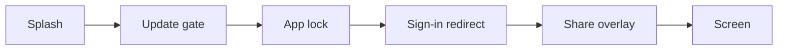
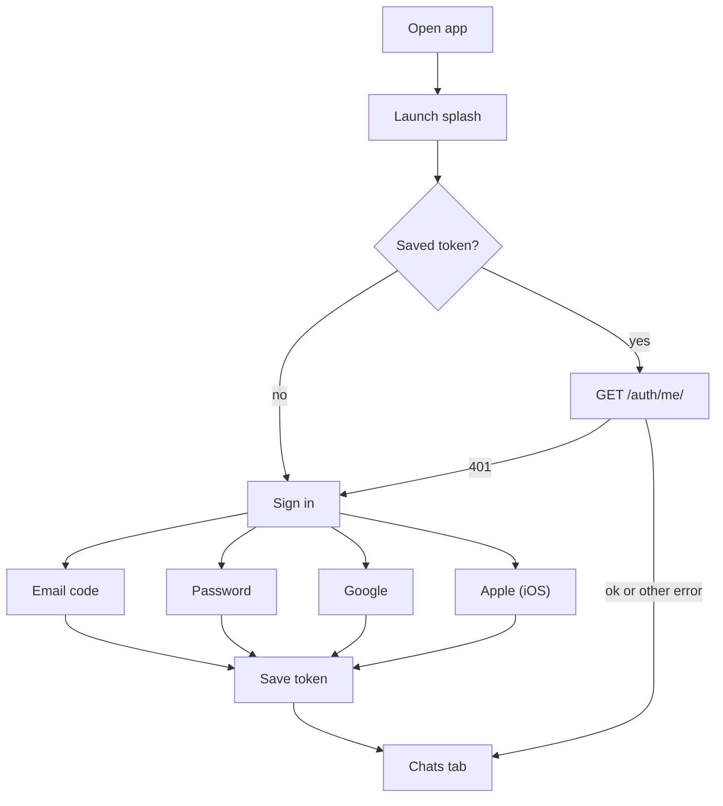
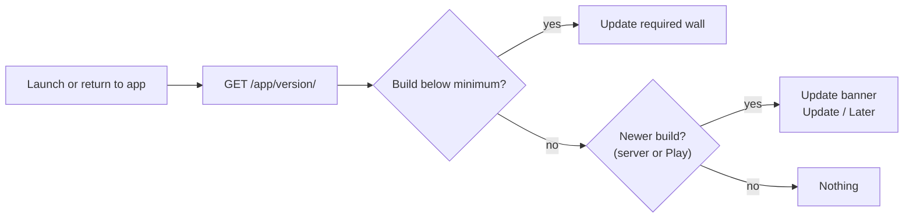
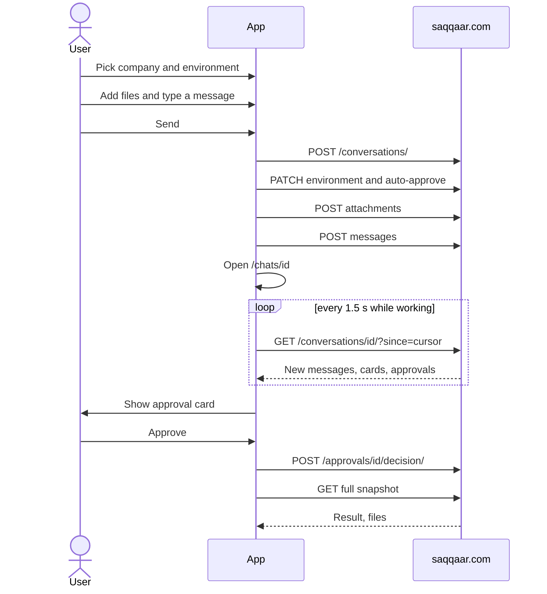
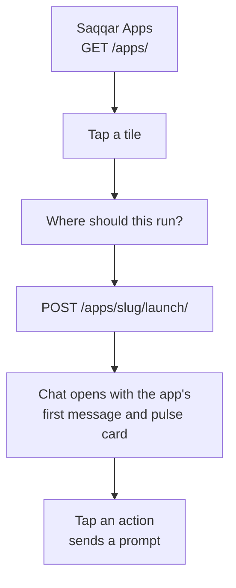
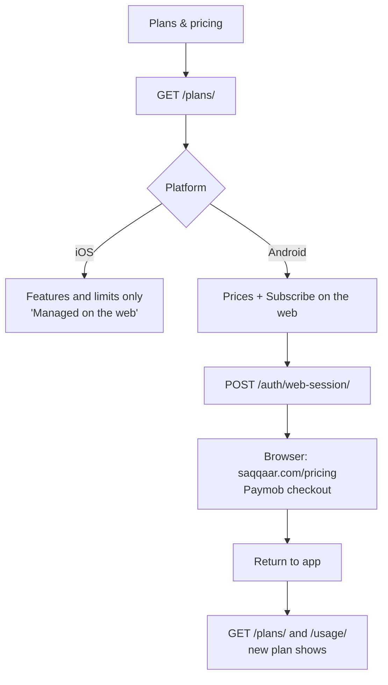
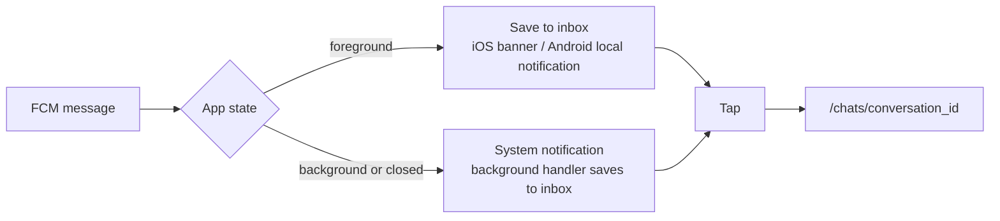
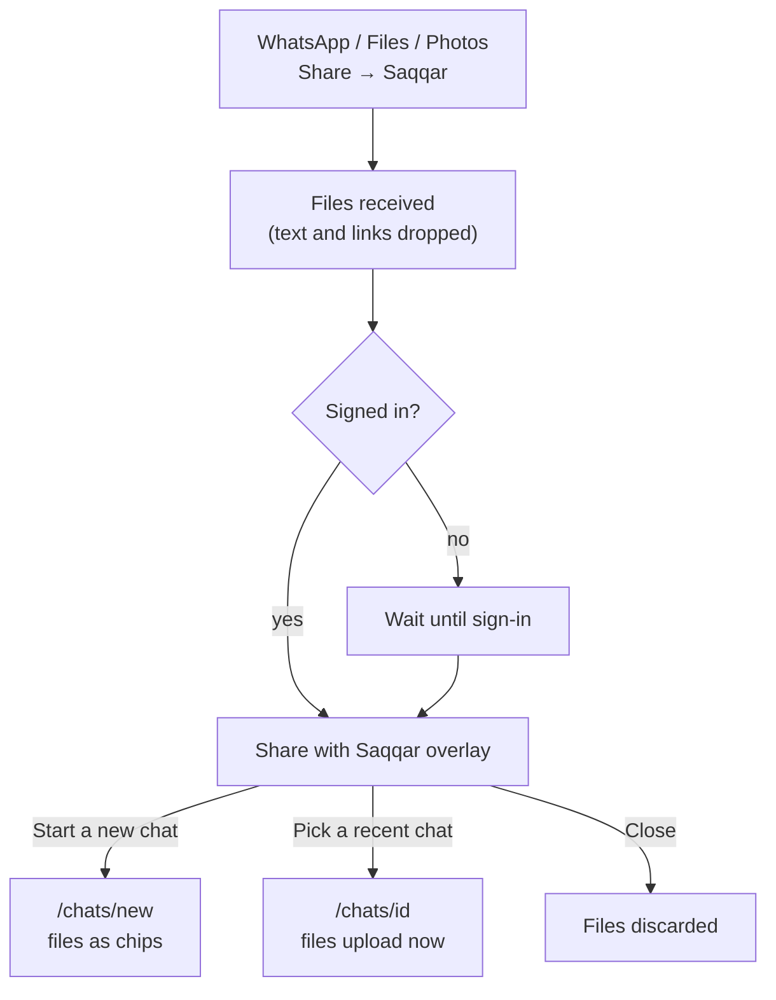

<!-- pdf:cover-start -->
# Saqqar — Mobile Implementation

**Design document** · Flutter app for Android and iOS, with an Apple Watch companion · Release `v1.2.24` (code at commit `48f0a70`, 2026-09-09) · Prepared 2026-09-17

This document covers the mobile app's screens, navigation, chat and cards, design system, data and configuration, and workflows, as they stand today. Everything was read directly from the codebase. It is the companion to *Saqqar — Web Implementation*.

| Screens | Card types | API endpoints | Workflows |
|---|---|---|---|
| 22 | 10 | 95 | 13 |

> **Core rule.** The app is a client of saqqaar.com and uses the same API as the web. Replies arrive by polling, not streaming. Any write to Odoo waits at an approval card in the chat.

## Contents

1. **Platform overview**: the app in numbers, and the stack
2. **Screens**: every route before and after sign-in, plus sheets and system screens
3. **Navigation**: tabs, gates, redirects, deep links
4. **Chat**: the core screen, including layout, composer, messages, approvals and files
5. **Cards**: the 10 card types and how they render
6. **Applications**: the app gallery and how an app starts
7. **Design system**: colors, typography, shape, layout, motion, language
8. **Data and configuration**: architecture, network, storage, runtime settings
9. **Workflows**: 13 flows, step by step
10. **Platform and release**: Android, iOS, Watch, CI
11. **Current state**: differences from the web, open items, issues found
12. **API reference**: all 95 endpoints, grouped by area
<!-- pdf:cover-end -->

## 1. Platform overview

| Metric | Value |
|---|---|
| Full screens | 22, plus 9 sign-in steps inside one screen |
| Sheets, dialogs and overlays | 20 |
| Routes | 18 screen routes, plus 1 redirect-only route |
| Bottom tabs | 3: Chats, Companies, Account |
| Feature modules | 20 |
| Dart files in `lib/` | 346 (about 73,600 lines) |
| Cubits / API clients / repositories | 21 / 21 / 2 |
| API endpoints | 95 |
| Chat card types | 10 (3 interactive and 7 app pulse), plus 2 approval cards |
| Applications | Sent by the server. The client knows 12; a standard user sees 11 |
| Languages | English and Arabic, 1,516 string keys each |
| Test files / test cases | 135 / about 1,683 |
| Released version | `v1.2.24`. The `pubspec.yaml` value `1.2.7+201` is stale, because CI sets the version from the git tag |

> **Core rule.** Saqqar reads the connected Odoo database freely. Any write pauses at an approval card and waits for confirmation. The mobile app renders that card; the server enforces the rule.

### Stack

| Area | Choice |
|---|---|
| Framework | Flutter, Dart `^3.9.2`. CI builds with Flutter 3.47.7 |
| State | Cubit + MVVM (`flutter_bloc`), with a shared `DataState<T>` (idle, loading, success, failure) |
| Routing | `go_router` |
| Network | `dio`, one client; the base URL is `https://saqqaar.com` |
| Storage | `flutter_secure_storage` for the token; `shared_preferences` for settings and caches |
| Sign-in | Email code, password, Google, and Apple (iOS only) |
| Push | Firebase Cloud Messaging and `flutter_local_notifications` |
| App lock | `local_auth` (Face ID, fingerprint, device PIN) |
| Deep links | `app_links` (Universal Links, App Links, `saqqar://`) |
| Crash reporting | Sentry. No Firebase Analytics or Crashlytics |
| Payments | No in-app purchase. Subscriptions are handled on saqqaar.com through Paymob |

The code is organised in four folders:

- **`lib/core`**: constants, error, format, i18n, logging, network, routing, state, storage and theme.
- **`lib/features/<feature>`**: one folder per feature, each with `data`, `view`, `view_model` and `widgets`.
- **`lib/shared`**: widgets, animations, extensions and session.
- **`lib/navigation`**: the tab shell.

The 20 feature modules are account, app_update, apps, auth, billing, chat, conversations, data_api, inbox, launch, meetings, notifications, push, security, share, storybook, support, trial, vault and watch.

## 2. Screens

### Before sign-in

| Route | Screen | Title | Contents |
|---|---|---|---|
| none | Launch splash | none (tagline "Odoo Operations Copilot") | Framed logo with a zoom-in, tagline and a thin progress bar. Stays 1.4 to 4 seconds while the saved session is checked |
| `/sign-in` | Sign in | Welcome back | Email code or password, Google, and Apple on iOS |
| `/sign-up` | Create account | Create your account | Email, then a 6-digit code, then name and password |
| inside `/sign-in` | Password reset | Reset your password | Email, then a code, then a new password |
| `/share/:token` | Shared conversation | Conversation title | Read-only copy of a shared chat with a READ-ONLY badge. Public; no sign-in needed |
| none | Update required | Update required | Full-screen wall with one "Update now" button. It also covers the sign-in screens |

The whole sign-in area is one screen (`AuthFlowScreen`) with nine steps. The URL does not change between steps. Every step has language and theme toggles at the top, the update banner, and the logo card.

| Step | Title (EN / AR) | Contents |
|---|---|---|
| Sign-up email | Create your account / أنشئ حسابك | Email, "Continue with email", Google (and Apple on iOS), "Sign in instead" |
| Sign-up code | Check your email / تحقّق من بريدك | Email chip with "Use different email", 6-digit code, "Verify code", resend after 60 seconds |
| Sign-up profile | Finish your profile / أكمل ملفك الشخصي | Read-only email, first and last name, password and confirmation (8 characters minimum), "Create account" |
| Sign-in email | Welcome back / مرحبًا بعودتك | Email, "Continue with email", "Continue with password", social buttons, "Create an account" |
| Sign-in code | Check your email / تحقّق من بريدك | Code, "Verify & sign in", "Continue with password instead" |
| Sign-in password | Enter your password / أدخل كلمة المرور | Email, password, "Forgot password?", "Login", "Continue with email instead" |
| Reset email | Reset your password / إعادة تعيين كلمة المرور | Email, "Send reset code", "Back to sign in" |
| Reset code | Check your email / تحقّق من بريدك | Code, "Verify code" |
| Reset password | Set a new password / تعيين كلمة مرور جديدة | New password and confirmation, "Set new password & sign in" |

### After sign-in: tabs and chat

| Route | Screen | Title (EN / AR) | Contents |
|---|---|---|---|
| `/chats` | Chats | Chats / المحادثات | Search, the All and Needs approval filters, date groups, an archived section, 30 rows per page, swipe to archive or delete |
| `/chats/:id` | Chat | Conversation title | The core screen. See section 4 |
| `/chats/new` | New chat | Start a conversation / ابدأ محادثة | The same screen, before the conversation exists on the server |
| `/vault` | Companies | Companies / الشركات | Company cards with their environments. Add, rename and delete. Opens the environment and credential sheets |
| `/account` | Account | Account / الحساب | Profile, preferences, security, password, devices, workspace and billing links, sign out, delete account |

### After sign-in: other screens

These screens open on top of the tabs, without the bottom bar.

| Route | Screen | Title (EN / AR) | Contents |
|---|---|---|---|
| `/apps` | Saqqar Apps | Saqqar Apps / تطبيقات صقّار | App gallery with group filters. A database picker opens before each app starts. See section 6 |
| `/pricing` | Plans & pricing | Plans & pricing / الباقات والأسعار | Plan cards from the server. On Android there are also prices, a monthly/annual switch and "Subscribe on the web" |
| `/usage` | Usage | Usage / الاستخدام | Plan badge and usage bars for the day, week and month |
| `/billing/history` | Billing history | Billing history / سجل الفواتير | Token balance, total purchased, payment cards with status, and a PDF receipt for each payment |
| `/notifications` | Notifications | Notifications / الإشعارات | Filters for All, Approvals, Tasks and Reports. Grouped by Today, Yesterday and Earlier. Swipe to dismiss; tap to open the chat |
| `/devices` | Devices | Devices / الأجهزة | Registered devices (platform, version, last seen) with "Sign out device" |
| `/trial` | Managed Odoo trial | Managed Odoo trial / تجربة أودو المُدارة | Request form, then a queued or building state, then the ready credentials (URL, database, login, password) with copy buttons |
| `/data-explorer` | Data explorer | Data explorer / مستكشف البيانات | Pick an environment and an operation (count, search, read-group, read, fields, SQL, report entities), edit a JSON body, run it, and view the JSON result |
| `/voice-support` | Support | Support / الدعم | Describe a problem and get a structured diagnosis and suggested reply. "Save as a ticket" creates an Odoo helpdesk ticket |
| `/meetings` | Meeting transcription | Meeting transcription / تفريغ الاجتماعات | Meeting URL, live transcript, stop, summarize, ask. **No entry point:** the Account link was removed on 2026-07-28 |
| none | File viewer | File name | Images with pinch-zoom, PDFs, and text files up to 512 KB. Other types open in another app |
| `/billing/checkout` | none | none | Redirects to `/pricing`. The checkout screen was removed |

### Account screen, top to bottom

1. **Profile card**: avatar, name and email; a role chip (Administrator, Staff or Standard user); plan badge; four counters (conversations, credentials, approvals, files); joined and last-login dates.
2. **Buttons**: "See plans" (Android only) and "Usage".
3. **Personal information**: editable first and last name, read-only email, "Save changes".
4. **Preferences**:
   - Theme: Light, Dark or System.
   - Language: English or Arabic.
   - Security: switches for App lock and Notifications.
5. **Change password**: collapsed by default.
6. **Manage devices**.
7. **Workspace**: Saqqar Apps, Managed Odoo trial, Data explorer.
8. **Billing**: Plans & pricing, Billing history.
9. **Sign out** (red button) and **Delete account** (text button). Footer: "Powered by Digital Harbor".

### Sheets, dialogs and overlays

| Name | Opened from | Contents |
|---|---|---|
| Share with Saqqar | Files shared from another app | Full-screen overlay: "Start a new chat" or pick one of the recent chats |
| Saqqar tools | The `+` button in the composer | Upload file; modes; Odoo tools; connections. See section 4 |
| Commands | Tools, then Commands | `/restart`, `/report`, `/sync`, `/logs`, `/backup`. Picking one inserts it into the composer |
| Task wording | Tools, then Task wording | Pre-filled text and "Structure task" |
| Attach | Tools, then Upload file | Photos, Camera, Files |
| Search in conversation | Chat search button | Searches the messages already loaded |
| Environments | Chat environment button | Checkbox list with LIVE, READ-ONLY and AUTO badges, and "Apply · N selected" |
| Live environment warning | First message sent to a live environment | Warning, "Don't ask again for this environment", Cancel, "Send to live" |
| Message actions | Long-press on your own message | Copy, Share |
| Conversation actions | Long-press on a chat row | Pin, Rename, Share link, Archive, Delete |
| Rename conversation | Row menu, or the pencil in the chat title | Title field; Save is enabled only after a change |
| Where should this run? | App tile | Company and database pickers, "Start", "Decide later in chat" |
| Companies | "Add company" on the Companies tab | Add a company; company cards with environment count and Delete |
| Company detail | Company card | Company name; environments with Live, Read-only and Auto-approve checkboxes; "Add environment" |
| Environment detail | Environment row | Rename. An "I'm a user" view (Odoo, Email) and an "I'm a developer" view (Odoo, PostgreSQL, server shell, GitHub, Email). One credential form per type |
| Company quick actions | Long-press on a company card | Rename, Delete |
| File details | Long-press on a generated file | The file's metadata as JSON |
| Confirm dialog | Many places | Yes / No, in red for destructive actions |
| Sign out | Account, lock screen | Confirm, biometric check if the lock is on, progress, toast |
| Delete account | Account | Confirm, biometric check, progress. The user is signed out only after the server confirms |

### System and developer screens

| Screen | Title | Contents |
|---|---|---|
| App lock | Saqqar is locked | "Authenticate to continue." The biometric prompt opens automatically. "Unlock" and "Sign out" buttons |
| Error screen | Something went wrong | Replaces Flutter's red error widget. Details appear only in debug builds |
| Unknown route | Route not found | Plain centred text |
| Storybook (`/_/storybook`) | Storybook | Component gallery for buttons, pills, inputs, switches, avatars, cards and empty states, with theme and language toggles. Opened by long-pressing the Account profile card. Available in release builds too |

> **No admin screens on mobile.** The only role-dependent element is the role chip on the profile card. Some tool rows appear only when a server feature flag is on.

## 3. Navigation

### Bottom bar

The bottom bar is a floating rounded pill with three tabs. Only the selected tab shows its label.

| Order | Route | Label (EN / AR) | Icon |
|---|---|---|---|
| 1 | `/chats` | Chats / المحادثات | message-circle |
| 2 | `/vault` | Companies / الشركات | briefcase |
| 3 | `/account` | Account / الحساب | circle-user-round |

The tab screens and the Support screen share one header:

- **Left:** the logo, which opens `/chats`. A dot pulses beside it while any chat is running.
- **Centre:** the page title.
- **Right:** a notifications bell with an unread count ("9+" at most), which opens `/notifications`.
- **Below:** the offline banner and the update banner.

Pressing back on a tab asks "Exit Saqqar?" before closing the app.

### Gates

Before any route is shown, the app passes through these layers in order:

| Gate | What it does |
|---|---|
| Launch splash | Shows for 1.4 to 4 seconds while the saved session is checked |
| Forced-update gate | Replaces the whole app, including sign-in, when an update is required |
| App-lock gate | Covers the app for signed-in users when the lock is on |
| Router redirect | Sends signed-out users to `/sign-in` |
| Share overlay | Appears when files shared from another app are waiting |

**Router redirect rules:**

- While the sign-in state is still loading, the router does not redirect.
- The public routes are `/sign-in`, `/sign-up` and anything under `/share/`.
- A signed-out user on any other route is sent to `/sign-in`.
- A signed-in user on `/sign-in` or `/sign-up` is sent to `/chats`.
- No redirect checks roles, plans or feature flags.
- Unknown paths show "Route not found".

**Transitions** (260 ms in, 200 ms out):

| Transition | Used for |
|---|---|
| Slide up | Tabs |
| Horizontal slide, mirrored in Arabic | Pushed screens |
| Fade | Sign-in, sign-up and shared chats |
| Scale | Storybook |

With the system's reduce-motion setting on, screens change with no animation.

### Deep links

The `app_links` plugin is the only link handler; Flutter's built-in deep linking is turned off on both platforms. The app handles links only after the first screen has loaded.

**`https://saqqaar.com` links:**

| Link | Opens |
|---|---|
| `/` | Chats |
| `/new` | New chat |
| `/chats`, `/chats/<id>` | Chats, or that chat |
| `/share/<token>` | Shared conversation |
| `/auth`, `/excel-addin`, `/settings`, `/admin`, `/static`, `/media`, and exactly `/privacy`, `/terms`, `/support`, `/refund`, `/cancellation` | An in-app browser view |
| anything else | Chats |

**`saqqar://` links:**

| Link | Opens |
|---|---|
| `saqqar://conversation/<id>` | That chat |
| `saqqar://approval/<id>?conversation=<cid>` | The chat. The approval ID is not used |
| `saqqar://share/<token>` | Shared conversation |
| `saqqar://credential/add` | `/vault/add`, which is not a registered route (see section 11) |

**Platform setup:**

- **Android:** a verified App Link filter for `saqqaar.com`, limited to `/`, `/new`, `/chats…` and `/share…`, plus the `saqqar` scheme.
- **iOS:** `applinks:saqqaar.com` in the entitlements, plus the `saqqar` URL scheme.

## 4. Chat

### Layout, top to bottom

| Zone | Contents |
|---|---|
| App bar | Menu button (opens the left drawer). The title scrolls when it is long, with a pencil to rename it and a pulsing "WORKING" pill. The subtitle shows the environment name with LIVE, READ-ONLY and AUTO badges. Then search and a bell with the pending-approval count, which opens the right drawer |
| Header strip | Company dropdown, and an environment button showing the main environment plus "+N" for the others. With no company: "Use My Database" |
| Banners | Offline banner. A report progress card ("Fetching N / M" or "Writing file… N rows") |
| Messages | Newest at the bottom. Date separators; the typing row; inline approval cards; a scroll-to-bottom button; pull to refresh; older messages load automatically |
| Empty chat | "What should we work on?" with a 2 × 2 grid: Explore my data, Summarize a document, Generate a report, Check server logs |
| Bottom band | "No database connected" hint, Resume banner, plan and quota banner, suggestion chips, task-wording card or hint, then the composer |

The chat has two drawers. Each is 86% of the screen width, up to 320 px, over a 55% black scrim.

| Drawer | Contents |
|---|---|
| Left | Logo, "New conversation", search, and the chat list grouped Today / Older (long-press for actions). Footer button to Companies |
| Right | Theme and language toggles. "Inbox", with three tabs: Pending approvals (N), Artifacts (N), and Server activity (always empty) |

### Messages

- **User messages:**
  - A cyan-tinted bubble on the end side, with a 4 px "cut" top-end corner that flips side in Arabic.
  - Width up to 88% of the screen, or 94% on screens 400 px wide or narrower.
  - "You · date and time" under the bubble.
  - Long-press offers Copy and Share.
- **Saqqar messages:**
  - No bubble; up to 96% of the width.
  - A meta line with the Saqqar logo, the time, and a token chip (tap it to see input, cached and output tokens).
  - Body rendered as Markdown: headings, lists, quotes, and code and tables that scroll sideways.
  - Long-press copies the message.
- **Working state:**
  - A typing row with three dots and a scanline, and a label that follows the current tool ("Checking Odoo data", "Building Excel report"…).
  - A collapsible "Saqqar thinking · N steps · 14s" pill lists the steps once the turn ends.
- **No regenerate, per-message retry or thumbs feedback.** Recovery comes from:
  - the **Resume** banner, when a run needs resuming;
  - the **Continue** button, when the server offers it;
  - **Stop**, which puts the last sent text back in the composer.

### How replies arrive

There is no streaming (no SSE and no WebSocket). The chat polls the conversation snapshot:

| Situation | Poll interval |
|---|---|
| Saqqar is working | Every 1.5 seconds |
| Right after a send | Every 1.5 seconds for 20 more ticks (about 30 seconds) |
| Idle | Every 15 seconds |
| App in the background | Paused; polls immediately on return |

To show a chat instantly, the app keeps the last 12 chats in memory and up to 60 on disk. The first load fetches 125 rows, and older pages load 100 to 500 rows at a time.

### Composer

The composer is one rounded pill with three rows:

1. **Text field**, 1 to 6 lines. Placeholder "Message Saqqar…", or "Saqqar is working — type your next task; send unlocks when done."
2. **Action bar:**
   - Start side: **`+`** (tools) and **mic**.
   - End side: mode badges (purple lightbulb for Task prep, cyan shield for Auto-approve), then the gradient **Send** button, which becomes **Stop** while running.
3. **Toggles:** Task prep (purple) and Auto-approve (cyan). Both are saved on the conversation.

**Saqqar tools sheet (`+`):**

| Section | Rows |
|---|---|
| Top | Upload file |
| Modes | Task wording, Task prep, Auto-approve |
| Odoo tools | Health radar, What-if and Business pulse (only when the server flag is on); Commands |
| Connections | My database (shows a hint only), Saqqar Apps, Companies, Voice support (only when its flag is on) |
| Footer | "Tools do not change Odoo without your approval." |

**Attachments:**

| Rule | Value |
|---|---|
| Sources | Photos (several at once), Camera (Android and iOS), Files (several at once) |
| Allowed types | Images (png, jpg, gif, webp, bmp, heic), pdf, csv/tsv, xlsx/xls/xlsm, docx/doc, zip/tar/gz/tgz |
| Size limit | 25 MB per file; 500 MB for archives |
| Photo resizing | Photos over 1 MB are resized to 1,600 px wide at JPEG quality 85. GIFs are left unchanged |
| Preview | A strip of 72 × 72 thumbnails, with the first page shown for PDFs. Tap to preview; "×" to remove |
| Upload | In an existing chat, files upload as soon as they are added, and their status is checked every second for up to 30 seconds. In a new chat, they upload on send |

**Voice input:**

- **Recording:**
  - Records AAC `.m4a` (mono, 16 kHz) for up to 2 minutes.
  - While recording, the composer shows a discard button, a pulsing red dot, a decorative waveform, a timer and a stop button.
- **Transcription:**
  - The recording goes to `POST /api/v1/transcribe/`, and the server detects the language.
  - The text is added to what is already in the composer.
- **Availability:** the mic is hidden when the plan has no voice feature, and disabled while Saqqar is working.

**Send rules:**

- Sending needs a selected environment. Otherwise a toast says "Choose a company and environment…".
- The first message to a LIVE environment opens the live-environment warning. The answer is saved for this chat, or for all chats.
- Send is disabled when offline, when the usage limit is reached, or when there is no text and no file.
- A 409 response means Saqqar is still working. A 402 response means the limit is reached.

### Approvals in the chat

Pending approvals appear in three places:

- inline at the end of the message list;
- in the right drawer;
- as a count on the bell and on the chat's row in the Chats list ("N TO APPROVE").

**Single approval card:**

- An amber shield icon.
- A plain-language title such as "Create 6 × Manufacturing Order".
- A risk chip: medium for credential requests, low for report exports, high for everything else.
- The request text, and an email preview for `send_email`.
- "Show details" for the full request.
- For a delete, a red box ("These N records will be deleted") that always lists the records.
- Buttons: **Reject**, and either **Approve** or a red **Delete N**.
- For edits that are not deletes, **Approve all similar requests**, with a tip that it also pre-approves future edits of the same kind in this chat.

**Grouped approval card:** similar Odoo edits of the same model and operation are grouped (never deletes). The card shows "N similar requests" with **Reject all N** and **Approve all N**, and "Show individual" for per-row decisions.

**The decision call:**

- The app sends `POST /api/v1/approvals/<id>/decision/`.
- For deletes, the server's confirmation phrase is sent back automatically.
- The chat then refreshes fully.
- Toasts:
  - "Approval granted. Executing approved action."
  - "Approval rejected."
  - "Approved N requests"

> **Deletes on mobile:** the typed-count confirmation was removed on 2026-08-17. The record list that is always visible and the red "Delete N" button serve as consent. Read-only and live environments are shown with badges; the server enforces the rules.

### Generated files

- **Listing:** files appear under **Artifacts** in the right drawer. Each row shows a colored format badge (XLSX green, PDF red, DOCX cyan, CSV amber, JSON purple), the name, the size and the date.
- **Opening:** tap downloads the file once to `saqqar_artifacts/` and opens it in the in-app viewer:
  - images with zoom;
  - PDFs;
  - text files as selectable monospace text; HTML shows as source, not rendered.
  - Word, Excel and archive files show an "Open in another app" button.
- **Details:** long-press shows the file's metadata.
- **Sharing:** there is no share button for files; "Open in another app" is the way to pass one on.

### Chats list

| Feature | Behaviour |
|---|---|
| Header | "Chats", with "N conversations · M pending", refresh, and a gradient "New conversation" button |
| Search | Matches the title and the last-message preview, including archived chats |
| Filters | All; Needs approval, with a count |
| Row | Letter avatar with a ring (cyan while running, green if updated in the last 2 hours), title, relative time, last-message preview (typing dots while running), pending pill, "company · environment", message and file counts |
| Pin | Pinned chats sort first. **Stored in memory only, so pins are lost when the app restarts** |
| Rename, share, archive, delete | From the row menu or a long-press. Share creates a public link and opens the system share sheet. Swipe right to archive, left to delete, in both languages |
| Groups and paging | Today / Yesterday / Previous 7 days / Older; archived chats are in a collapsible section. 30 per page |
| Refresh | Pull to refresh, plus a silent refresh every 20 seconds while the app is open |
| Offline | The list is cached and shown instantly on launch. The top 5 chats are also saved for 10 minutes |

## 5. Cards

The server marks a message with a `tool_payload.kind`, and the app picks the card from that value. If the data can't be read, the message is shown as plain text.

| Group | Card types | When it renders |
|---|---|---|
| Interactive | `prompt_clarify`, `report_builder`, `prompt_suggestion` | Only when Saqqar is idle. While it is working, they show as thinking steps |
| App pulse | `factory`, `inventory`, `finance`, `purchasing`, `quality_guard`, `accountant`, `hr` | Always. The action buttons are hidden when sending isn't possible |
| Approval | Single, grouped | Pending approvals, whatever else the message holds |

> **Rule.** A pulse card appears only inside its own application. The server applies this rule by sending the card only when the chat belongs to that app; the app itself does not check.

### Interactive cards (cyan edge)

| Card | Shows | Actions |
|---|---|---|
| Clarifying questions | "A couple of quick questions": 1 to 3 questions with choice chips and a "Something else…" field | "Prepare & review" places the answers in the composer; "Build & send" sends them |
| Report builder | "Build a report": chips for Type, Period, View and Format, and a searchable picker for customers, vendors or employees | "Build report", enabled once a type is chosen |
| Prompt suggestion | "A clearer way to ask": an editable, improved version of the request | "Keep mine" hides the card; "Approve & use" sends the edited text |

### App pulse cards

Every pulse card uses the same frame, from top to bottom:

1. A header with the icon, the app name, and "As of {date}".
2. A grid of stat tiles. A missing value shows "—"; an unavailable one shows "Unavailable"; warning and danger values are tinted.
3. Action rows. The first button is filled, the rest are outlined, and a tap sends a prompt.
4. Question chips and a free-text box.
5. Detail lists.
6. The server's Notes and Priorities.

| Card | App (EN / AR) | Stat tiles | Action buttons |
|---|---|---|---|
| Factory | Your factory / مصنعك | MOs running, MOs late, POs late, orders at risk, MOs done today | Per order at risk: "Delivery date", "Cover shortage" |
| Inventory | Your inventory / مخزونك | Products, value, low stock, demand shortage, stagnant, missing data, overstock, fast reorder, sales days | Review shortage, Open zero stock, Suggest reorder, Show stagnant, Review excess, Review data. Chips: Track shipments, Stalled transfers, Stock accuracy, Locate a product |
| Finance | Your money / فلوسك | Cash, receivables overdue and due soon, payables overdue and due soon, draft bills and invoices, bank reconciliation, liquidity | Cover gap, Start collection, Plan payments, Reconcile bank, Review close. Lists: collection aging, payment horizon |
| Purchasing | Your purchasing / مشترياتك | Open RFQs, awaiting approval, late POs, late receipts, to bill, vendor bills | Chase supplier, Review approval, Close decision, Start matching, Prioritize bills |
| Quality Guard | Quality Guard / حارس الجودة | 13 counts and 2 amounts: out of spec, failed checks, swaps, deep discounts, substitutes, cost saving… | Review measurements, Open rejects, Review swap, Find user, Review substitutes, Prepare limits |
| Accountant | Your accounts manager / مدير حساباتك | Month, plus 5 check tiles | Review entries, Check invoices, Reconcile bank, Review tax, Close the month… Chips: The opinion, Transit accounts, Financial statements, Ledger integrity, Trial balance, Duplicates, Chart of accounts, Setup |
| HR | Recruitment Manager / مدير التوظيف | Active employees, missing managers, missing work email, recruitment, payroll, time off | Screen applicants, Shortlist best, Review contracts, Review payroll, Review leaves, Review attendance |

### Other elements in the message list

- Thinking pill and typing row.
- Continue button.
- Token chip.
- Date separator.
- Report progress card.
- Attachment chips: an image preview, a file row, or a gallery strip for 2 or more files.

The "Artifact ready" pill and the tool-activity card exist in the code, but real chat data never triggers them today.

## 6. Applications

The server supplies the app list (`GET /api/v1/apps/`); the client no longer has a hard-coded list. The server sends English only, and the client translates names and taglines by slug.

- **Screen:** "Saqqar Apps" is a grid with 2 columns, or 3 on screens at least 640 px wide. Group filter pills appear when there are two or more groups.
- **Tile:**
  - an icon chosen by group, tinted with the app's accent color;
  - the name and tagline;
  - the group label, in the accent color;
  - a server icon when the app needs a connected database.
  - The server's own SVG icon is not shown, because the app has no SVG library.
- **Starting an app:**
  1. The user taps a tile. **"Where should this run?"** opens, with company and database pickers and a red LIVE chip on live databases.
  2. The user picks **Start** or **Decide later in chat**.
  3. The app calls `POST /api/v1/apps/<slug>/launch/`, which returns a conversation.
  4. The chat opens on the app's first message.

| App | Name (EN / AR) | What it does | Accent | Card |
|---|---|---|---|---|
| `finance-pulse` | Your money / فلوسك | Collect, pay, reconcile and close the day from Odoo's financial data | from server | finance |
| `purchase-pulse` | Your purchasing / مشترياتك | Purchase orders, late receipts, vendor bills and risk | from server | purchasing |
| `smart-inventory` | Your inventory / مخزونك | Shortages, stagnant stock, overstock, missing data, reorder signals | from server | inventory |
| `quality-guard` | Quality Guard / حارس الجودة | Specs, failed checks, product swaps and cheaper substitutes | from server | quality_guard |
| `hr-assistant` | Recruitment Manager / مدير التوظيف | Applicants, employees, contracts, payroll, time off and attendance | from server | hr |
| `accountant` | Your accounts manager / مدير حساباتك | Entries, the invoice chain, bank, tax and month-end close | from server | accountant |
| `factory` | Your factory / مصنعك | Production status, missing material and a realistic delivery date | `#F97316` | factory |
| `zatca` | ZATCA e-invoicing / الفوترة الإلكترونية (زاتكا) | Saudi Fatoora Phase 2 onboarding: CSR, OTP, go-live | `#14B8A6` | none |
| `chart-of-accounts` | Chart of Accounts builder / مُنشئ شجرة الحسابات | Build or import a localized chart of accounts and its default postings | `#6366F1` | none |
| `bank-reconciliation` | Bank reconciliation / التسوية البنكية | Bank journals, statement import and matching rules | `#8B5CF6` | none |
| `whatsapp` | WhatsApp integration / تكامل واتساب | Connect WhatsApp Business (Cloud API) to Odoo | `#25D366` | none |
| `meetings` | Meeting notetaker / مدوّن الاجتماعات | Record, transcribe and summarize meetings | hidden by the server | none |

The accent colors come from the server; only the five shown above appear in the repo, in a captured test response. The Arabic names for the first four apps are marked in the code as proposals still awaiting product sign-off.

**Icons by group:**

| Group | Icon |
|---|---|
| Accounting | Calculator |
| Finance | Landmark |
| Integrations | Puzzle |
| Sales, CRM | Chart |
| Purchasing, Inventory, Manufacturing | Briefcase |
| HR | User |
| Operations | Bolt |
| Reporting | Table |
| Compliance | Shield |
| Anything else | Grid |

## 7. Design system

The design values are defined as tokens in `lib/core/theme/`. A source test fails the build when a color, radius, font size, icon size, spacing value or duration is typed as a literal outside those files.

### Colors

| Token | Dark | Light |
|---|---|---|
| Background | `#030712` | `#F8FAFC` |
| Surface (cards, sheets, dialogs) | `#111827` | `#FFFFFF` |
| Surface 2 (inputs, chips, skeletons) | `#1E293B` | `#F1F5F9` |
| Surface 3 (tooltips, switch off) | `#0F172A` | `#E2E8F0` |
| Text | `#F8FAFC` | `#0F172A` |
| Muted text | `#94A3B8` | `#64748B` |
| Border | `#1E293B` | `#E2E8F0` |
| Card fill | `#111827` at 70% | white at 85% |
| Brand cyan (primary) | `#06B6D4` | `#06B6D4` |
| Brand purple (secondary) | `#8B5CF6` | `#8B5CF6` |
| Brand navy (tertiary, button background) | `#1F3C88` | `#1F3C88` |
| Success / warning / danger | `#10B981` · `#F59E0B` · `#EF4444` | same |

<!-- pdf:swatches -->

**Gradients:**

- **Primary:** navy `#1F3C88` to cyan `#06B6D4`, from top-left to bottom-right. It fills the Send button, primary buttons, active filter chips, sheet handles and the top bar of dialogs.
- **Vivid:** cyan to purple, used for avatars.
- **Other colors:**
  - Avatars rotate through six gradient pairs.
  - An information color doesn't exist; cyan is used for it.
  - Approval cards use an amber edge, and interactive cards a cyan edge.

### Typography

All fonts ship with the app, so nothing is downloaded at runtime. The font is chosen by the app's language, not character by character.

| Font | Use |
|---|---|
| Space Grotesk (variable) | English and every non-Arabic language |
| Tajawal 400, 500, 700, 800 | Arabic (since 2026-08-23) |
| IBM Plex Sans Arabic | Arabic fallback |
| JetBrains Mono | Code and technical values |

| Style | Size / weight | Style | Size / weight |
|---|---|---|---|
| Display large | 28 / 700 | Body large | 16 / 400, line height 1.5 |
| Display small | 24 / 700 | Body medium | 14 / 400, line height 1.5 |
| Headline large | 22 / 700 | Body small | 13 / 400, muted |
| Headline medium | 20 / 700 | Label large | 14 / 600 |
| Headline small | 18 / 700 | Label medium | 12 / 600, muted |
| Title large | 16 / 600 | Label small | 11 / 700, muted |
| Title medium | 15 / 600 | Eyebrow | 11 / 700, uppercase, cyan |
| Title small | 14 / 600 | Status pill | 10 / 700, uppercase |

- **Chat text:** the composer and Markdown use 15 px. Markdown headings are 19, 17 and 16 px.
- **Text size:** the system text size is limited to between 0.85× and 1.4×.
- **Tabular figures:** stat tiles, timers, token chips and progress cards use tabular figures, so numbers don't shift as they change.

### Shape and components

| Element | Value |
|---|---|
| Radii | Card 20, modal 18, input 14, button 12, toast 12, bubble 16, sheet top 24, pill 999, bottom bar 22 |
| User bubble | 14 on three corners, with a 4 px "cut" top-end corner |
| Spacing | Published scale: 4, 8, 12, 16, 20, 24, 32. The code uses 2 px steps (most often 14, 10 and 6) |
| Elevation | Flat. Surfaces are separated by borders and transparency, not shadows |
| Primary button | Navy-to-cyan gradient, radius 12, 48 px minimum height, white 600-weight label. Shows three animated dots while loading |
| Ghost button | Surface 2 fill with a border. A danger version is red |
| Input | Surface 2 fill, radius 14. The border turns cyan (1.5 px) on focus and red on error |
| Card | Translucent card fill, 1 px border, radius 20, padding 16. Blur is available but off by default |
| App bar | 60 px high. The iOS back arrow is used on every platform |
| Tab header | 62 px high. The shadow deepens once the page scrolls |
| Bottom sheet | Top radius 24, with a 64 × 3 gradient handle |
| Dialog | Up to 380 px wide, radius 20, with a 3 px gradient bar along the top |
| Toast | Floating, up to 420 px wide, with a colored border (success, error, info). Shown for 3 seconds, or 5 for errors |
| Touch targets | Icon buttons 44 px, Send 42 px, buttons at least 48 px |

### Layout

- **Screen sizes:**
  - Width steps: tiny up to 340, compact up to 400, regular up to 600, wide above 600.
  - They affect only message width, one inline form and the paging bar.
- **Tablets:**
  - No two-pane layout.
  - Content width is capped instead: messages at 760, the composer and header at 980, other screens at 920, the sign-in card at 440.
- **Sheets:** 85% of the screen height, or 92% for tall ones.
- **Orientation:** not locked. iPhone and iPad support landscape.
- **Keyboard:** tapping empty space closes it.

### Motion

| Token | Duration | Used for |
|---|---|---|
| Route in / out | 260 / 200 ms | Every screen transition (easeOutCubic / easeInCubic) |
| Fast | 180 ms | Tab bar, composer, scroll button, thinking pill |
| Card in | 220 ms | Offline banner, header shadow, typing label crossfade |
| Sheet in | 280 ms | Chat sheets and overlays |
| Typing dots | 1,100 ms loop | Three dots fading in turn |
| Skeleton shimmer | 1,200 ms | Loading placeholders |
| Agent pulse | 1,400 ms | Running dot and the WORKING pill |
| Scanline | 2,600 ms | Sweep across the typing bubble |
| Recording pulse | 900 ms | Red dot while recording voice |
| Splash | 1,600 ms | Logo scales from 0.25 to 1 and fades in |

- **Reduce motion:** every looping animation and every route transition respects the system's reduce-motion setting.
- **Haptics** are used in 29 places:
  - selection clicks on toggles and chips;
  - a light tap on Send;
  - a medium tap on approvals and long-press actions.

### Theme and language

- **Theme:**
  - Light, Dark or System; System is the default.
  - Saved on the device and applied instantly, with no flash on launch.
- **Language:**
  - English or Arabic, following the system when not set.
  - Saved on the device.
  - Changing it also updates the push notification language.
- **Strings:**
  - One Dart file with 1,516 keys in each language; no ARB files.
  - Arabic has all six plural forms.
  - A test checks that both languages have the same keys and placeholders.
- **Right-to-left:**
  - Arabic switches the whole layout to right-to-left.
  - Arrows and sign-in/out icons are mirrored, as are the user bubble corner, the card edges and the slide direction.
  - The tab header keeps the logo on the left in both languages.
- **Mixed Arabic and English:**
  - Approval cards, email previews and pulse cards set each string's direction from its own text.
  - Chat messages and the composer follow the app language.
- **Numbers:** Western digits in both languages. Dates show as "Today", "Yesterday" or a short date; relative times go from "now" to "N days ago".

### Shared widgets and assets

- **Shared widgets:**
  - 55 files in `lib/shared/widgets`: buttons, cards, dialogs, toasts, banners, empty and error states, skeletons, pills, chips, search and filter bars, the paging bar, avatars, and the page scaffolds.
  - 4 animations: typing dots, pulse dot, scanline, floating bob.
- **Images:**
  - Launcher icons and one logo (`logo-light.png`, tinted white on dark backgrounds).
  - No Lottie, Rive or SVG files; illustrations are icons (Lucide) and effects drawn in code.
- **Store images:** `live_assets/` holds the App Store and Play Store images; `store_ready_pro/` is the final set.
- **Figma export:** `design/` exports the real theme and 9 screens to Figma (`flutter test test/figma_export_test.dart`).

> **Older design docs are out of date.**
>
> - `docs/MOBILE_UI_DESIGN.md` (May) lists Inter, a cyan-to-purple button gradient, different radii and motion values, and a tablet two-pane layout. None of these match the code.
> - `docs/design_handoff/SAQQAR_DESIGN_BRIEF.md` (June) still matches the colors, type sizes and radii, but not the fonts.
>
> This document follows the theme code.

## 8. Data and configuration

### Architecture

**Startup order:**

1. Sentry starts.
2. Firebase starts in the background.
3. The app builds 21 API clients, 2 repositories and the services.
4. 14 app-wide cubits are created:

   | Area | Cubits |
   |---|---|
   | Look and language | Theme, Locale |
   | Session and access | Connectivity, Auth, App lock, App update |
   | Settings and plan | Task prep, Notification settings, Plan, Saqqar features |
   | Chats and companies | Running agents, Approvals, Conversations, Vault |

5. The launch splash shows, then the router.

**Other cubits:** 7 are scoped to a single screen: Chat, Apps, Trial, Meetings, Data explorer, Shared transcript and Auth flow.

### Network

| Setting | Value |
|---|---|
| Base URL | `https://saqqaar.com` (build flag `SAQQAR_BASE_URL`). No flavors |
| Timeouts | Connect 15 s, send 30 s, receive 30 s. The web-session hand-off uses 6 s |
| Headers | `Accept: application/json` and `Accept-Language: ar` or `en` on every request |
| Auth | `Authorization: Bearer <token>`, sent only to the API host. There is no token refresh |
| 401 | If the response says the session has ended, the token is cleared and the user goes to sign-in |
| Errors | All errors become typed failures: network, timeout, 401, 403, 404, validation (400/422), 409, 429, 413, 402, 415, 503, 5xx, and Odoo unreachable (502/504). A `200` with `ok:false` also counts as an error |
| Logging | Debug builds only, capped at 800 characters, with passwords, tokens and secrets redacted |
| Offline | A connectivity watcher drives the offline banner and disables Send. Nothing is queued |

**Build flags:**

| Flag | Default | Purpose |
|---|---|---|
| `SAQQAR_BASE_URL` | `https://saqqaar.com` | API host |
| `SAQQAR_SENTRY_DSN` | empty | Sentry is off when empty |
| `SAQQAR_GOOGLE_SERVER_CLIENT_ID` | built-in web client ID | Google sign-in |
| `SAQQAR_WEB_SUBSCRIBE` | empty: off on iOS, on on Android | Shows prices and "Subscribe on the web" |

### Local storage

| Key | Stores |
|---|---|
| `saqqar.auth.access` (secure) | The access token (Keychain on iOS, encrypted preferences on Android) |
| `saqqar.theme` / `saqqar.locale` | Theme and language |
| `saqqar.taskPrep` | Device default for Task prep (on) |
| `saqqar.app_lock.enabled` | App lock on or off (kept after sign-out) |
| `saqqar.notifications.push_enabled` | Push on or off |
| `saqqar.notifications.inbox.v1` | In-app notification list (up to 50) |
| `saqqar.app_update.dismissed_build` | The build whose update banner was dismissed |
| `saqqar.conversations.cache.v1` | Cached chats list and pending counts |
| `saqqar.vault.cache.v1` | Cached companies, environments and credential schemas. Never credential values |
| `liveAck.conv.<chat>.<env>` / `liveAck.global.<env>` | Live-environment warning acknowledged |
| `vaultPersona.<env>` | User or developer view in the environment sheet |

**Files on the device:**

- `chat_snapshots/`: up to 60 cached chats.
- `saqqar_artifacts/`: downloaded files and receipts.
- A temporary folder for voice notes and camera photos.

**Signing out clears:**

- the companies and chats caches;
- the saved chats;
- the notification list.

**Signing out does not clear:**

- the downloaded files;
- the live-warning and view choices;
- the theme, language and lock settings.

### Runtime settings

| Setting | Value |
|---|---|
| Chat poll: working / idle | 1.5 s / 15 s |
| Extra fast polls after a send | 20 ticks (about 30 s) |
| Attachment status check | Every 1 s, for up to 30 s |
| Chats list refresh | Every 20 s, paused in the background |
| Chats list fetch | 200 per request, up to 12 requests; shown 30 per page |
| "Live" chat | Updated within the last 2 hours |
| Chat pre-download | Top 5 chats, 40 rows each, kept 10 minutes, 2 at a time |
| Code resend | 60 s; 6-digit code; passwords of 8 characters or more |
| Splash | 1.4 s minimum, 4 s maximum |
| Update check | On launch and on return to the app, at most every 6 hours |
| Trial and meeting status | Every 5 s while in progress |
| Voice note | Up to 120 s |
| Text size | 0.85× to 1.4× |
| Sentry trace sample rate | 0.1 |

**Feature flags from the server:**

`GET /api/v1/usage/` returns a `saqqar_features` object:

- **Hidden unless on:** Health radar, What-if, Business pulse, Voice support.
- **Shown unless off:** Task prep, Task wording.
- **Exempt plans:** staff and superusers see everything.

The plan's `features` object controls the mic (`voice`) and the developer credential types.

## 9. Workflows

### W1. First launch and sign-in

1. The splash checks the saved session. If there is no token, or the server returns 401, the user goes to sign-in. Any other error keeps the user signed in.
2. **Sign in by email code:**
   1. The app calls `POST /api/auth/login/email/start/`.
   2. The user enters the 6-digit code, and the app calls `.../verify/`.
   3. The token is saved, and `GET /auth/me/` loads the profile.
   4. The code can be resent after 60 seconds.
3. **Sign in by password:** the app calls `POST /api/v1/auth/login/`. A 401 shows "invalid credentials".
4. **Sign in with Google:** the app always shows the account chooser, then sends the ID token to `POST /api/v1/auth/google/`. Cancelling does nothing.
5. **Sign in with Apple** (iOS only): the app sends the ID token and name to `POST /api/v1/auth/apple/`.
6. **After sign-in:** the router moves to `/chats`, which shows the cached list first. It then loads the chats (`GET /conversations/?limit=200&include_archived=1`) and the pending approvals.

**There is no onboarding or intro screen.**

### W2. Sign up and password reset

1. **Sign up:**
   1. The user enters an email, and the app calls `POST /api/auth/signup/start/`.
   2. The user enters the code, and the app calls `.../verify/`, which returns a sign-up token.
   3. The user enters a name and password, and the app calls `.../complete/`.
   4. If no session comes back, the app signs in automatically with the new password. If that fails, it opens the password step with a note.
2. **Reset password:**
   1. The app calls `POST /api/auth/password/reset/start/`. The server answers the same way for unknown emails.
   2. The user enters the code, and the app calls `.../verify/`, which returns a reset token.
   3. The app calls `.../complete/` with the new password, then signs the user in.
3. **Change password** (Account): the app calls `POST /api/v1/auth/password/` and saves the new token. Other devices are signed out.

### W3. App lock

1. **Turning it on:** in Account → Preferences, the switch asks for Face ID, fingerprint or PIN first. If that fails, the switch stays off.
2. **When the app locks:**
   - on every cold start;
   - every time the app goes to the background.
   - There is no timeout. The notification shade and other brief interruptions do not lock the app.
3. **The lock screen:**
   - It covers the app and hides the content from screen readers.
   - The authentication prompt opens automatically.
   - "Unlock" retries; "Sign out" is the way out.
4. **Order with the update wall:** the forced-update wall sits outside the lock, so it shows without unlocking.

### W4. App update

1. **Checking:** the app checks after launch and on every return to the app, at most every 6 hours.
2. **Update required:** when the build is below the server's minimum, a wall with "Update now" replaces the whole app. The wall appears only if a store link exists.
3. **Update available:** when the build is below the latest, or Google Play reports an update, a banner shows "Update" and "Later". "Later" hides it for that build.
4. **"Update now":**
   1. On Android, the app tries Google Play's in-app update first.
   2. If that isn't possible, it opens the store page.
   3. If that fails, it shows an error toast.
5. **Current status:** the server endpoint returns 404 today, so only the Android Play banner is active.

### W5. New chat, message, reply and approval

1. **Start a chat:** "New conversation" opens `/chats/new`. Nothing exists on the server yet.
2. **Choose where it runs:** the user picks a company and one or more environments. "Use My Database" instead calls `POST /projects/default/`.
3. **Attach files:** the user taps `+` and then Upload file. The files are checked against the size limits and shown as chips. In a new chat they upload later, on send.
4. **Send checks:**
   - If no environment is selected, a toast appears.
   - If the environment is live and not yet acknowledged, the live warning opens.
5. **First send in a new chat:**
   1. The app creates the conversation, titled with the first 70 characters of the message.
   2. It sets the environment and the auto-approve setting.
   3. It uploads the files.
   4. It sends the message with `task_prep`.
   5. It opens `/chats/<id>`.
   - If anything fails, the text and files are put back in the composer.
6. **Sending in an existing chat:** the files are already uploaded. The app sends the message and switches to fast polling. A 409 response means Saqqar is still working; a 402 response means the limit is reached.
7. **Waiting for the reply:**
   - Each poll adds new messages and replaces the rest of the snapshot.
   - The screen shows the thinking pill, the progress card and any cards.
   - **Stop** calls `POST …/stop/`.
   - **Resume** calls `POST …/resume/`.
8. **Approving:**
   1. The user approves or rejects the card, and the app calls `POST /approvals/<id>/decision/`. For "approve all" it adds `scope: "batch"`, and for deletes it adds the confirmation phrase.
   2. The chat reloads fully and the card disappears.
9. **The result:** Saqqar continues on the server. The next polls bring the result and any generated files.

### W6. Open an application

1. The user opens **Saqqar Apps** from Account or from the chat tools. The app loads `GET /apps/`.
2. The user taps a tile. The launch dialog opens; if there is only one company, it is already selected.
3. The user chooses a database, or "Decide later in chat".
4. The app calls `POST /apps/<slug>/launch/`, with "Opening…" shown on screen. A failure shows "Couldn't open this app".
5. The chat opens, and the app's first message arrives through polling.
6. **The pulse card:** when a message carries a pulse type, its card renders. Each action button sends its prompt through the normal send checks.

### W7. Add Odoo credentials

1. **Load the data:** the Companies tab loads `GET /projects/` and `GET /credentials/schemas/`.
2. **Create a company and environment**, or reuse existing ones:
   - `POST /projects/`.
   - `POST /projects/<id>/environments/`, with the live, read-only and auto-approve flags.
3. **Open the environment:**
   - The app calls `GET /environments/<id>/credentials/`.
   - The user picks the user view (Odoo, Email) or the developer view (all 5 types).
4. **Fill in the form:** the fields come from the server's schema. Choosing an authentication type (password or API key, SSH password or key) shows only the fields that apply.
5. **Detect databases:** the app calls `POST /credentials/databases/` with the URL, and the database field becomes a picker.
6. **Test the connection:** `POST /credentials/test/`. A green or red badge shows the result, with the server's error message when there is one.
7. **Save:**
   - `PUT /environments/<id>/credentials/<kind>/`.
   - The server connects before it saves, so wrong credentials fail here.
   - On success, a toast says "Saved".
8. **Delete:** confirm, then `DELETE …/credentials/<kind>/`.

### W8. Plans, subscription and usage

1. **Usage:**
   - Account loads `GET /usage/` when it opens and whenever the app returns. This returns the plan, the day, week and month limits, and the token balance.
   - The Usage screen shows the same data as bars.
2. **iOS:**
   - There are no prices, Subscribe buttons or upgrade prompts. The iOS release build forces this setting.
   - The pricing screen compares features and limits and notes that plans are managed on the web.
3. **Android:**
   1. The user taps "Subscribe on the web", and the app calls `POST /api/v1/auth/web-session/`.
   2. If that returns a signed-in link on saqqaar.com, the browser opens it.
   3. If it fails with 404 or 400, the browser opens the plain `/pricing/?plan=<slug>` page. A 401 or a network error shows a toast and opens nothing.
   4. The user pays through Paymob on the web.
   5. Back in the app, the plans and usage reload.
4. **Receipts:** in Billing history, "Receipt" downloads `GET /billing/receipt/<ref>/` and opens the PDF.
5. **No in-app purchase** on either platform. A test checks for this.

### W9. Push notification to screen

1. **Registration:**
   - The app asks for permission. Android 13 and later show their own prompt.
   - The app registers the token with `POST /api/v1/devices/`, including the app version and language.
   - A token refresh registers again.
   - Android uses two notification channels: approvals (high priority) and updates.
2. **App in the foreground:**
   - The message is saved to the in-app notification list.
   - iOS shows the banner. Android shows a local notification on the matching channel.
3. **App in the background or closed:** the system shows the notification, and a background handler adds it to the list.
4. **Tapping a notification** opens `/chats/<conversation_id>`. The notification type is not used.
5. **Bell:** `/notifications` marks everything as read, and tapping a row opens its chat.
6. **Settings:**
   - The Notifications switch in Account registers the device (on) or removes it (off).
   - Changing the language registers the device again with the new language.

### W10. Share a file into Saqqar

1. **Receiving the files:**
   - **Android:** the app accepts single and multiple shares of `image/*`, `application/*` and `text/*`.
   - **iOS:** a Share Extension saves the files to a shared app-group folder. The app checks that folder at launch and on every return.
2. **Filtering:** shared text and links are dropped. A new share replaces any earlier batch.
3. **The overlay:** "Share with Saqqar" covers the screen and offers "Start a new chat" or the recent chats. A signed-out user sees it after signing in.
4. **Where the files land:** the chosen chat receives them as composer chips, with the same size limits as regular uploads. Nothing is sent automatically.

### W11. Universal Links and App Links

1. **Link setup:**
   - **iOS:** associated domain `applinks:saqqaar.com`.
   - **Android:** a verified filter for `/`, `/new`, `/chats…` and `/share…`.
2. **Handling:** the app reads the launch link and then listens for new ones. It maps each link using the tables in section 3.
3. **Sign-in:** the sign-in redirect still applies. A signed-out user who opens a chat link lands on sign-in, and after signing in goes to `/chats`, not to the linked chat.
4. **Shared links:** `/share/<token>` loads `GET /api/v1/shares/<token>/` without sign-in and shows the read-only chat. Closing it opens `/chats`.

### W12. Trial, voice support and devices

1. **Managed Odoo trial:**
   1. The app checks `GET /trial/status/`.
   2. With no trial, the user fills in the form, and the app calls `POST /trial/`.
   3. While the trial is queued or building, the app checks every 5 seconds.
   4. **Ready:** the credentials card appears, with the password hidden until revealed.
   5. **Failed:** an error with Retry appears.
2. **Voice support** (only when its flag is on):
   1. The user describes the problem, and the app calls `POST /voice-support/draft/`.
   2. The app shows a draft: what we understood, the likely cause, a suggested reply, steps to try, and open questions.
   3. The user confirms, and the app calls `POST /voice-support/ticket/`, which creates an Odoo helpdesk ticket.
3. **Devices:** `/devices` lists the devices (`GET /devices/`), and each device can be signed out (`DELETE /devices/<id>/`).

### W13. Sign out and delete account

1. **Sign out:**
   1. The user confirms.
   2. If the lock is on, the app asks for biometrics.
   3. A progress dialog appears.
   4. The local caches are cleared.
   5. The app calls `POST /auth/logout/` (a failure doesn't stop the sign-out) and deletes the token.
   6. A toast appears, and the app goes to sign-in.
2. **Delete account:**
   1. The user confirms, and the app asks for biometrics if the lock is on.
   2. The app calls `POST /api/v1/account/delete/`. This call must succeed.
   3. The app deletes the token, clears the caches and shows a toast.
   4. If the call fails, the user stays signed in and sees the error.
3. **Session ended by the server:** a 401 with `auth:false` clears the token and returns the user to sign-in.

## 10. Platform and release

| | Android | iOS |
|---|---|---|
| App ID | `sa.com.digitalharbor.saqqar` | `sa.com.digitalharbor.saqqarapp` |
| Minimum OS | Flutter default (API 24 with the local SDK) | iOS 15.0 |
| Permissions | Internet, network state, biometrics, notifications, microphone. The media-read permissions are explicitly removed | Camera, Face ID, microphone, photo library. Each has an English and an Arabic explanation |
| Deep links | Verified App Links for `saqqaar.com`, plus `saqqar://` | `applinks:saqqaar.com`, plus `saqqar://` |
| Share in | Share intents for single and multiple files | Share Extension with the App Group `group.sa.com.digitalharbor.saqqar` |
| Backup | Off (`allowBackup=false`); cloud backup and device transfer excluded | Default |
| Other | Cleartext traffic off. Impeller disabled. Minify off | Push entitlement: `development` for debug, `production` for release |
| Store | Google Play, `internal` track by default | TestFlight through fastlane |

- **Apple Watch companion** (watchOS 10):
  - Shows the newest 10 pending approvals, and approve or deny taps call the decision endpoint.
  - Voice commands are transcribed and sent to a chat. A new chat created from the watch is set to auto-approve.
- **Firebase:**
  - Project `saqqar-ai`, used for push only.
  - Crash reports go to Sentry.
  - Google sign-in uses a separate Google Cloud project.
- **CI** (`.github/workflows`):
  - **`ci.yml`:** analyze and test on every push and pull request, plus a debug APK on push.
  - **`release.yml`:** runs on a `v*` tag:
    1. analyze and test;
    2. version: the name comes from the tag, and the build number is `200 + run_number×10 + attempt−1`;
    3. build a signed Android App Bundle and upload it to Play;
    4. build the iOS app with fastlane and upload it to TestFlight.
  - Promotion to production is manual.
- **Pre-commit hook** (`.githooks`): runs `flutter analyze` and `dart format` on the staged files.
- **Tests:**
  - 135 files, with about 1,683 cases.
  - They cover networking, chat polling and merging, approvals, cards, attachments and voice, conversations, the vault, billing, deep links, the platform manifests, i18n parity, responsive layouts, and code-level rules.
  - There are no integration tests.

## 11. Current state

### Differences from the web

This table compares the web behaviour described in *Saqqar — Web Implementation* with the mobile app.

| Topic | Web | Mobile |
|---|---|---|
| Scheduled tasks | Screen with run and stop controls | Not implemented |
| Admin / settings hub | Tools, users, costs, gateways and more | None |
| Meetings | Admin-only app | Screen exists; no entry point; app hidden by the server |
| Reply delivery | Not stated in the web document | Polling every 1.5 s while working |
| Card types | 11, including Cash Flow and Pricing Monitor | 10. Cash Flow is "Your money" (`finance`); there is no Pricing Monitor card |
| App names | Hiring Manager, Accounting Manager | Recruitment Manager, Your accounts manager |
| Pinning | Saved on the account, shared across devices | Kept in memory only; lost when the app restarts |
| Revoking a share link | Available | API exists; no button |
| Delete approval | Type the count, such as "delete 3" | Visible record list and a red "Delete N" button |
| Search inside a chat | Title and message text | Messages already loaded only |
| Generated files | "Generated files" page for each chat | Artifacts tab in the right drawer |
| Upload limits | 25 MB file, 200 MB video, 500 MB archive | 25 MB file, 500 MB archive. Video can't be picked |
| Direction of mixed text | Per paragraph in the composer | App language; per string only in approval and pulse cards |
| Checkout | Pricing and checkout pages | Android opens the web checkout; iOS shows no prices |
| Brand colors | Cyan `#43C2C4`, navy `#4660B8`, dark background `#0E1322` | Cyan `#06B6D4`, navy `#1F3C88`, dark background `#030712` |
| Fonts | Hanken Grotesk and Tajawal | Space Grotesk and Tajawal |

### Open items with the backend

- **Payments:** the Paymob callback did not mark payments as paid (3 attempts still pending on 2026-08-03). A `ref` from billing history is rejected by the payment-status endpoint.
- **Update checks:** `GET /api/v1/app/version/` returns 404, so the forced-update check is inactive.
- **Feature flags:** `saqqar_features` is staff-only for regular accounts, so Radar, What-if, Pulse and Voice support stay hidden. The store-review account needs the staff flag.
- **Questions still open:**
  - Is the SQL endpoint read-only on the server?
  - Is trial auto-provisioning on?
  - Does the pricing page pre-select `?plan=`?
- **Data mismatches:**
  - Billing history is in SAR while checkout is in USD.
  - The app icon is not rendered, because no SVG library is included.

### Issues found while reading the code

| # | Issue | Where |
|---|---|---|
| 1 | Right after sign-in, the auth listener calls `push.start()` and then `push.stop()`, so a fresh sign-in never registers for push until the next cold start. Sign-out no longer removes the device. The sign-out branch was lost in commit `208574a` (2026-08-03) | `lib/app.dart` lines 162–179 |
| 2 | "Sign out" on the lock screen asks for biometrics again, so a user who can't authenticate can't sign out there | `sign_out_helper.dart`, `AppLockCubit.confirm` |
| 3 | `saqqar://credential/add` opens `/vault/add`, which is not a route, so the user sees "Route not found" | `deep_links.dart`, `route_names.dart` |
| 4 | `?approval=<id>` from links is never read | `deep_links.dart`, `chat_screen.dart` |
| 5 | Tapping a push notification ignores its type. Quota warnings don't open Usage | `push_notifications_service.dart` |
| 6 | `saqqaar.com/pricing` links open Chats, not Pricing | `deep_links.dart` |
| 7 | Downloaded files and receipts stay on the device after sign-out | `LocalSessionCaches.clear` |
| 8 | Pins are not saved | `conversations_cubit.dart` |
| 9 | Storybook can be opened in release builds | `account_screen.dart` |
| 10 | Data explorer sends SQL with no client-side guard | `data_explorer` |
| 11 | Unused code: remote i18n bundle, `ApprovalsCubit`, 14 API methods with no caller, credential-request forms that are parsed but never shown | Several files |
| 12 | Stale documents: `docs/RELEASE.md` (version, build-number formula, test count), `docs/MOBILE_UI_DESIGN.md`, the `pubspec.yaml` version | `docs/`, `pubspec.yaml` |

## 12. API reference

All paths are relative to `https://saqqaar.com`. Endpoints marked "no caller" are defined in a client but nothing calls them. Endpoints marked "no sign-in" are sent without the token, and so is the whole unversioned `/api/auth/` group.

### Auth and account (21)

| Method | Path | Note |
|---|---|---|
| POST | `/api/v1/auth/login/` | Password sign-in; no sign-in |
| POST | `/api/v1/auth/register/` | No caller; no sign-in |
| POST | `/api/v1/auth/google/` | `{id_token}`; no sign-in |
| POST | `/api/v1/auth/apple/` | `{id_token, user?}`; no sign-in |
| POST | `/api/auth/signup/start/` · `verify/` · `resend/` · `complete/` | Email sign-up (4 endpoints) |
| POST | `/api/auth/login/email/start/` · `verify/` · `resend/` | Email-code sign-in (3 endpoints) |
| POST | `/api/auth/password/reset/start/` · `verify/` · `resend/` · `complete/` | Password reset (4 endpoints) |
| POST | `/api/v1/auth/logout/` | Sign out |
| POST | `/api/v1/account/delete/` | Delete account |
| GET / PATCH | `/api/v1/auth/me/` | Profile; update name (2 endpoints) |
| POST | `/api/v1/auth/password/` | Change password; returns a new token |
| POST | `/api/v1/auth/web-session/` | Signed-in web link for checkout |

### Conversations and chat (21)

| Method | Path | Note |
|---|---|---|
| GET / POST | `/api/v1/conversations/` | List (`limit`, `offset`, `include_archived`); create |
| GET / PATCH / DELETE | `/api/v1/conversations/{id}/` | Snapshot (`since`, `before`, `limit`); update title, archive, auto-approve, task prep, environments; delete |
| POST | `/api/v1/conversations/{id}/stop/` · `resume/` | Stop or resume a run |
| POST | `/api/v1/conversations/{id}/messages/` | `{content, attachment_ids, task_prep}` |
| POST | `/api/v1/conversations/{id}/attachments/` | Multipart `files` |
| GET | `/api/v1/conversations/{id}/attachments/{aid}/status/` | Upload status |
| POST / DELETE | `/api/v1/conversations/{id}/share/` | Create a share link; revoke (no caller) |
| POST | `/api/v1/conversations/{id}/credentials/active/` · `toggle/` | No caller |
| POST | `/api/v1/conversations/{id}/pending-actions/dismiss/` | No caller |
| POST | `/api/v1/radar/run/` · `/api/v1/pulse/run/` · `/api/v1/whatif/intro/` | Saqqar tools `{conversation_id, lang}` |
| GET | `/api/v1/prompt-memory/` | Task wording |
| POST | `/api/v1/transcribe/` | Voice note, multipart `audio` |
| GET | `/api/v1/report-entities/` | Report builder record picker |

### Approvals and files (4)

| Method | Path | Note |
|---|---|---|
| GET | `/api/v1/approvals/` | `status`, `limit`, `offset` |
| POST | `/api/v1/approvals/{id}/decision/` | `{approved, scope?, confirm_phrase?}` |
| GET | `/api/v1/artifacts/` | No caller |
| GET | `/api/v1/artifacts/{id}/` | File details |

### Companies, environments and credentials (22)

| Method | Path | Note |
|---|---|---|
| GET | `/api/v1/credentials/schemas/` | Form schemas |
| POST | `/api/v1/credentials/test/` · `databases/` | Test connection; list Odoo databases |
| GET / POST / PATCH / DELETE | `/api/v1/credentials/…` | Named credentials, 5 endpoints; no caller |
| GET / POST | `/api/v1/projects/` | Companies |
| POST | `/api/v1/projects/default/` | "Use My Database" |
| GET / PATCH / DELETE | `/api/v1/projects/{id}/` | GET has no caller |
| POST | `/api/v1/projects/{pid}/environments/` | `{name, is_live, read_only, auto_approve}` |
| GET / PATCH / DELETE | `/api/v1/environments/{id}/` | GET has no caller |
| GET | `/api/v1/environments/{id}/credentials/` | Credentials on an environment |
| GET / PUT / DELETE | `/api/v1/environments/{id}/credentials/{kind}/` | Read, save and delete one credential |

### Odoo data (6)

| Method | Path | Note |
|---|---|---|
| POST | `/api/v1/environments/{id}/odoo/search/` · `count/` · `read-group/` · `read/` · `fields/` | Data explorer |
| POST | `/api/v1/environments/{id}/sql/` | Data explorer; 502 and 504 mean Odoo is unreachable |

### Billing, apps, trial and support (10)

| Method | Path | Note |
|---|---|---|
| GET | `/api/v1/plans/` · `/api/v1/usage/` | Plans; usage, plan and feature flags |
| GET | `/api/v1/billing/history/` · `/api/v1/billing/receipt/{ref}/` | Payments; PDF receipt |
| GET | `/api/v1/apps/` | App gallery |
| POST | `/api/v1/apps/{slug}/launch/` | `{environment_id?}`; returns `conversation_id` |
| GET / POST | `/api/v1/trial/status/` · `/api/v1/trial/` | Managed trial |
| POST | `/api/v1/voice-support/draft/` · `ticket/` | Voice support |

### Meetings (5)

These are reachable only from the hidden meetings screen. The paths have no trailing slash.

| Method | Path | Note |
|---|---|---|
| POST | `/api/v1/meetings/` | Start with `{url}` |
| GET | `/api/v1/meetings/{id}/transcript` | Transcript |
| POST | `/api/v1/meetings/{id}/stop` · `summarize` · `chat` | Stop, summarize, ask |

### Devices, sharing, update and i18n (6)

| Method | Path | Note |
|---|---|---|
| GET / POST | `/api/v1/devices/` | List; register the push token `{platform, token, app_version, locale}` |
| DELETE | `/api/v1/devices/{id}/` | Remove a device |
| GET | `/api/v1/shares/{token}/` | Public shared chat; no sign-in |
| GET | `/api/v1/app/version/` | `?platform=android` or `ios`. Returns 404 today |
| GET | `/api/v1/i18n/{lang}.json` | No sign-in; no caller |

Files are also downloaded directly from the URLs the server returns. The token is attached only when the URL is on the API host.
